# 保全ナレッジAI（RAG のデモ）

工場の点検記録（Excel）、保全マニュアル（PDF）、紙の報告書をスキャンした PDF、会議の議事録（Word）から探して、どの資料のどこに書いてあるかを示しながら答える、社内向けの検索 AI（RAG）のデモです。
「P-101 で異音が出たときは、どう対応した？」と聞くと、過去の記録・報告書・マニュアルの該当箇所を番号つきで示します。資料に書かれていないことは「見つからない」と答えます。

ブラウザで試せるデモ：https://yutennnnn-hozen.onrender.com

- 画面は、よく使われているチャットのアプリと同じ作りです（左に履歴、下に入力欄、右に出典）。続けて質問もできます。
- データはすべて架空です。実在の工場・会社・人物とは関係ありません。
- デモは API キーを設定していない「引用のみ」で動いています（AI の代わりに、検索で見つけた記録と文をそのまま並べて答えます）。
- しばらく使われていないと、最初の表示に1分ほどかかります。止まるたびに質問の履歴は消えます。
- 左の履歴には、自分のブラウザで聞いた質問だけが出ます。「質問ログ」の画面は見直し用なので、ほかの人の質問も見えます。実在の情報は入れないでください。
- ソースコードは非公開です。

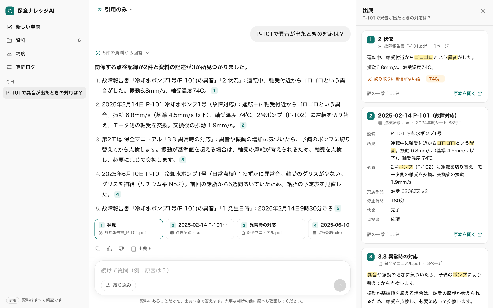

| 続けて質問する（「原因は？」を P-101 の話として探す） | 言い換えでも見つける（「異音」→「ガタガタ」） |
|---|---|
| 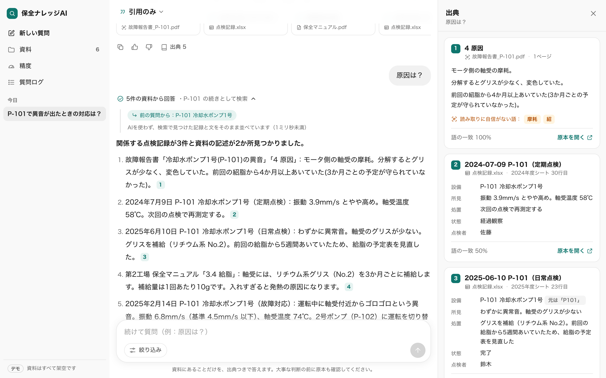 | 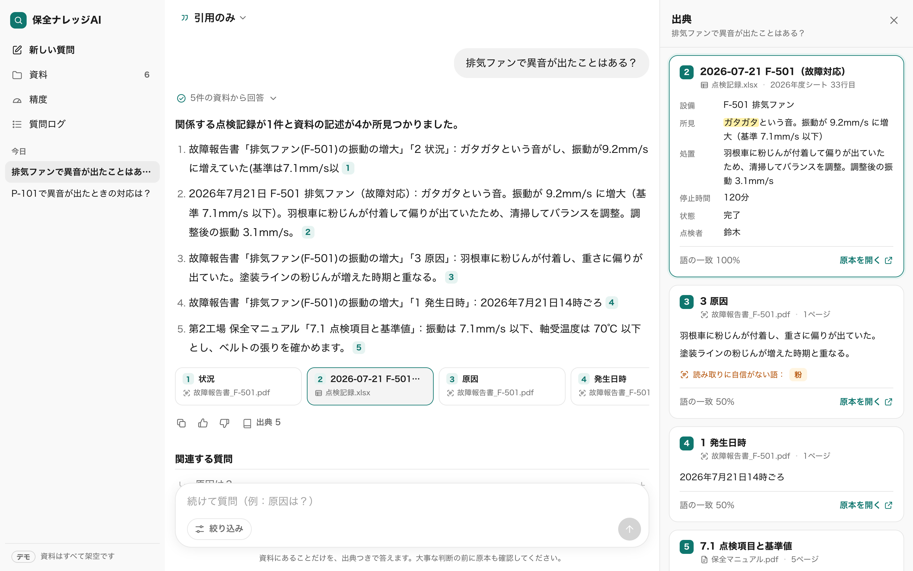 |

| 資料にない質問には答えない | ホーム（左に履歴） |
|---|---|
| 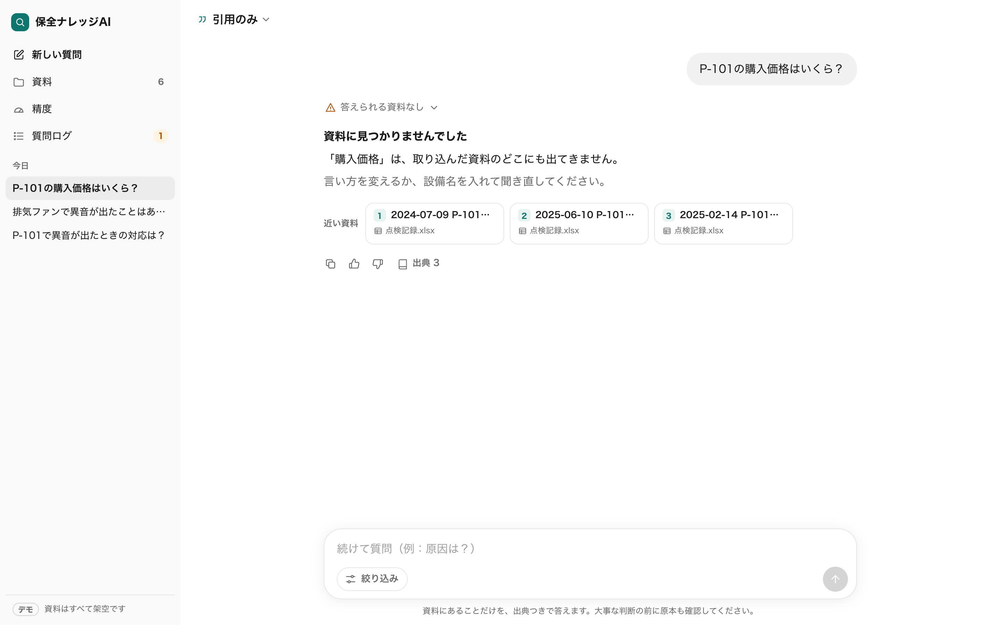 | 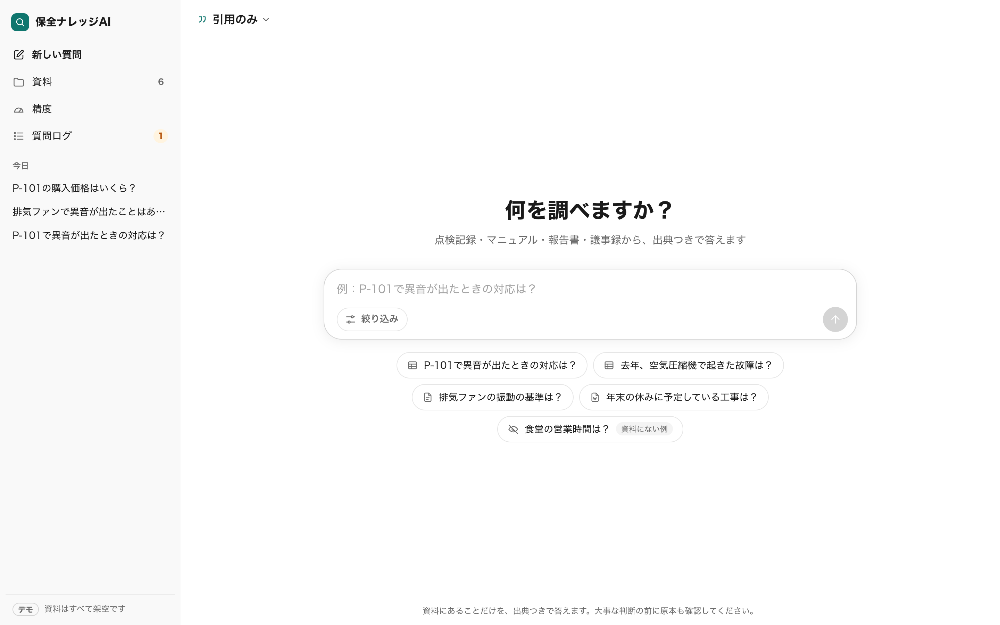 |

| スキャンの読み取り結果（自信の低い語に枠） | 精度の確認（工夫ごとの正解率） |
|---|---|
| 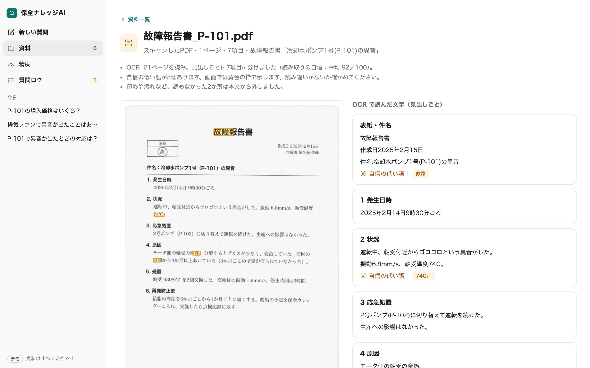 | 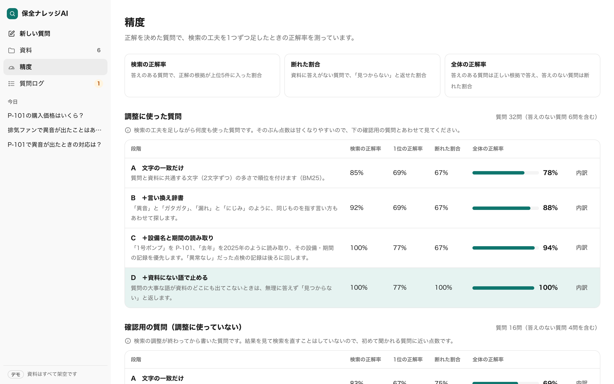 |

| スマホ：質問 | スマホ：答え | ダークモード |
|---|---|---|
| 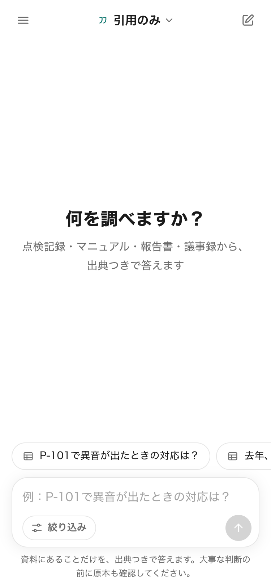 | 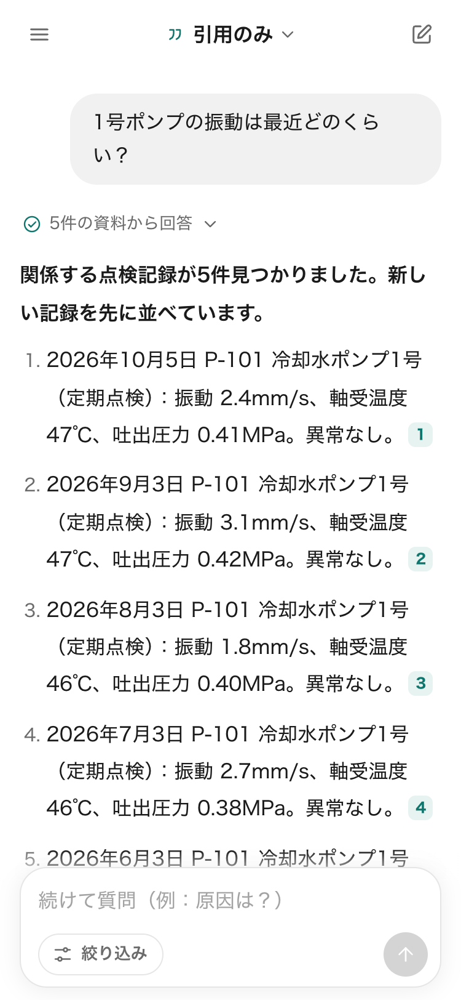 | 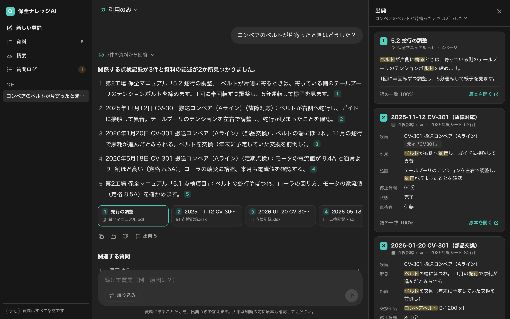 |

## できること

- 取り込み：形式ごとに読み方を変えて、検索と引用の単位に分ける
  - Excel：1行を1件の記録として扱う。見出しの行を探し、列の名前の違い（所見／内容 など）も吸収する。設備番号の書き方の違い（P101、Ｐ－１０１ など）をそろえる
  - 文字を選べる PDF：「3.2 点検項目と基準値」のような番号つきの見出しごとに分ける。各ページの上下の見出しとページ番号は外す
  - スキャンした PDF：Tesseract（日本語）で OCR してから、見出しごとに分ける。読み取りの自信が低い語は、画面で黄色の枠を付けて「要確認」にする
  - Word：見出しごとに分ける
- 質問の読み取り
  - 設備の呼び方を設備番号に読み替える（「1号ポンプ」「冷却水ポンプ1号」→ P-101）。呼び方は `config/equipment.yaml` に足せる
  - 同じものを指す言い方もあわせて探す（「異音」と「ガタガタ」、「漏れ」と「にじみ」、「片寄る」と「蛇行」）。辞書は `config/synonyms.yaml`
  - 期間を読み取る（「去年」「2025年度」「先月」）。「最近」「最新」と聞かれたら、新しい記録を先に並べる
- 答え
  - 答えの文ごとに出典の番号を付ける。番号や出典のカードを押すと、右の「出典」の欄に元の資料の該当箇所を、質問の語に印を付けて出す。「原本を開く」で元の資料（Excel の行、PDF の節、スキャンの原本）に移れる
  - 続けて質問できる。「原因は？」のように設備名を省いたときは、前の質問の設備の話として探し、そのことを答えの上に書く。会話は左の履歴に残る
  - 答えのあとに、続けて聞けそうな質問を出す（その設備で答えが見つかるものだけ）
  - 質問の大事な語が資料のどこにも出てこないとき、または大事な語の半分以上を含む資料がないときは、答えずに「見つからない」と返す
  - 設備・資料の種類・年度で絞り込める（入力欄の「絞り込み」から選ぶ）
  - 答え方（AIで回答／引用のみ）を画面の上で切り替えられる
- 改善の仕組み
  - 評価：正解を決めた質問で、検索の工夫ごとの正解率を測る（画面と `python -m app.evaluate`）
  - 答えの評価：答えごとに「良い／良くない」を付けられる。「良くない」のときは理由（資料が違う・情報が足りない・情報が古い・その他）を選ぶ
  - 質問ログ：答えられなかった質問と「良くない」と評価された答えを一覧にし、CSV で出せる。言い換え辞書や資料を足す手がかりにする
- API：`POST /api/ask` で、社内のほかのシステムからも同じ答えを受け取れる。`thread_id` を渡すと続けて質問できる（説明は `/api/docs`）

## 答えの正しさを測る

正解の根拠を決めた質問で、検索の工夫を1つずつ足したときの正解率です。答えのない質問（「食堂の営業時間は？」など）も混ぜ、「見つからない」と返せたかも数えています。

| 段階 | 調整に使った質問（32問） | 確認用の質問（16問・調整に使っていない） |
|---|---|---|
| A 文字の一致だけ（BM25） | 78% | 69% |
| B ＋言い換え辞書 | 88% | 81% |
| C ＋設備名と期間の読み取り | 94% | 81% |
| D ＋資料にない語で止める | 100% | 88% |

- 左の列の質問は、検索の工夫を足しながら何度も使ったので、点数は甘くなりやすいです。右の列は調整が終わってから書いた質問で、結果を見て検索を直すことはしていません
- 確認用の質問で外れた2問は、「2026年に止まった時間がいちばん長かった故障は？」（並べ替えや合計が要る集計の質問）と、「保全会議に出た人は？」（議事録の書き方は「出席」）です。集計は表から計算する仕組みを別に足し、言い換えは質問ログを見ながら辞書に足していく運用を想定しています
- 指標の内訳（検索の正解率・1位の正解率・断れた割合など）は [docs/eval_result.md](docs/eval_result.md) にあります

## AI に答えさせるときの考え方

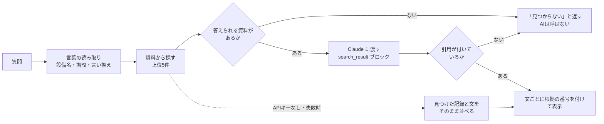

- 検索結果は、Claude API の「検索結果（search_result）ブロック」として渡し、引用（citations）を有効にします。引用は API が「どの資料のどの文か」を返すもので、AI が文を書き換えて引用することはできません
- 引用が1つもない答えは、資料に基づかない可能性があるので表示しません。引用のない文に数字があるときは、画面で点線を付けて、引用がないことを示します
- 検索で「見つからない」と判定した質問は、AI を呼ばずにそう答えます。答えようのない質問で費用がかかりません
- 資料どうしで内容が違うとき（古いマニュアルと新しい報告書など）は、両方を日付つきで示し、新しいほうを先に書くよう指示しています
- API キーがない、接続できない、回答が断られた、のどれかのときは、AI を使わない答えに切り替えて動き続けます

API 経由で送ったデータの扱い（保存期間・学習への利用の有無）は提供元の規約で決まります。導入するときは、最新の規約と契約の内容を確認したうえで設定します。

## 設計で意識したこと

- 検索は「文字の2文字ずつの組（バイグラム）」の BM25 に、設備台帳と言い換え辞書を組み合わせています。形態素解析の辞書や埋め込みのモデルを使わないので、型番・略語・OCR の読み違いに強く、依存が軽いので小さなサーバーでも動かせます。なぜその資料が選ばれたかを、語の一致で説明できます
- 埋め込み（ベクトル）検索は、評価の質問で効果を測ってから足す前提です。入れ替えても同じ評価で比べられるように、検索と評価を分けて作っています
- 「異常なし」の定期点検の記録は、出来事を聞く質問では後ろに回します。同じ設備の記録が毎月あり、そのままだと「漏れ・にじみなし」のような記録が上に来るためです
- 1つの文書から出す項目は3つまでにし、記録・マニュアル・報告書がほどよく混ざるようにしています
- 取り込むときに直したこと（設備番号の書き方をそろえた件数、外したページ番号、OCR で読めなかった箇所）は、資料の画面に書いて残します
- 画面は、使い慣れたチャットのアプリにそろえました。答えは吹き出しにせず本文として読みやすくし、出典は右の欄にまとめて、答えと見比べられるようにしています
- ボタンの文字は短くし（「新しい質問」「絞り込み」「原本を開く」など）、アイコンだけのボタン（コピー・良い・良くない）には名前を出します。続けて質問したときに前の設備を引き継いだことや、言い換えて探した語は、答えの上の「〇件の資料から回答」を開くと確かめられます

## 構成

```
app/
  main.py        画面と API（FastAPI）。質問・会話・資料・精度・質問ログ・CSV
  ingest.py      資料の取り込み（Excel・PDF・スキャンした PDF・Word）と設備台帳
  ocr.py         スキャンした PDF の OCR（Tesseract・日本語）。結果はファイルごとに保存して読み直さない
  textnorm.py    文字のそろえ方（全角・半角、設備番号、長音）、バイグラム、印の付け方
  search.py      検索（BM25・言い換え・設備名と期間・資料にない語の判定）
  answer.py      答えの作り方（AI なし／Claude の引用つき）
  evaluate.py    評価（工夫の段階ごとの正解率）
  store.py       質問ログと会話の履歴（SQLite）
  templates/     画面（Jinja2）。会話は chat.html と _turn.html、入力欄は _composer.html。アイコンは _icons.html に自前で描いた線画
  static/        CSS（スマホ対応、ダークモード）と JavaScript
config/          設備台帳（equipment.yaml）と言い換え辞書（synonyms.yaml）
eval/            評価の質問と正解（questions.yaml：調整用、holdout.yaml：確認用）
samples/         架空の資料と、スキャンした PDF の OCR の結果（_ocr/）
scripts/         架空の資料の作成、README のスクリーンショットの撮影
tests/           pytest（取り込み・検索・答え・画面と API）
```

## 実際に導入するときに足すところ

- 資料の取り込み：共有フォルダや SharePoint などから定期的に取り込み、変わった資料だけを読み直す
- 権限：部署や役職ごとに、見られる資料を分ける
- 集計の質問：「いちばん長かった」「何件あった」のような質問は、記録の表から計算して答える仕組みを別に足す
- 検索：資料の量や言い回しの幅に応じて、埋め込み（ベクトル）検索を足し、評価で効果を確かめる
- ログイン：社内の認証（SSO など）とつなぐ

## 技術

Python 3.12 / FastAPI / Jinja2 / HTML・CSS（レスポンシブ）/ JavaScript / pdfplumber・pypdfium2 / Tesseract OCR / openpyxl / python-docx / BM25（自前の実装）/ Anthropic Python SDK（search_result・citations）/ SQLite / pytest / Docker
